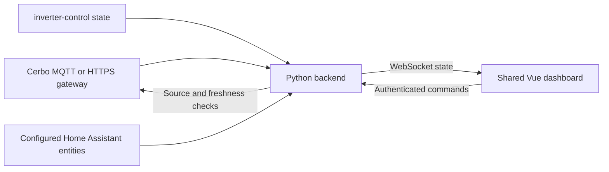

# System architecture

The Python backend serves the shared Vue dashboard, combines telemetry from the
selected native source with controller state and optional Home Assistant data,
and validates browser commands before dispatch.

Native services, controller messages and configured HA entities have distinct
field ownership. Source changes retire the old connection's authority; retained
or stale telemetry does not grant permission to issue commands. A transport
accepting a command is separate from observing its physical result.

The detailed [architecture and source map](../../docs/architecture.md) describes the current
implementation. Use [configuration](../../docs/configuration.md) for supported keys, paths and
precedence, and [operations and troubleshooting](../../docs/wiki/Troubleshooting.md) for installation
and read-only checks. The browser bundle is maintained in
[inverter-dashboard-vue](https://github.com/victron-venus/inverter-dashboard-vue).

## Related documentation

- [inverter-control architecture](https://github.com/victron-venus/inverter-control/blob/main/.github/docs/system-architecture.md)
- [ADR-002: MQTT bridge architecture](https://github.com/victron-venus/inverter-control/blob/main/.github/docs/adr-001-grid-zero-architecture.md#adr-002-mqtt-bridge-architecture)
