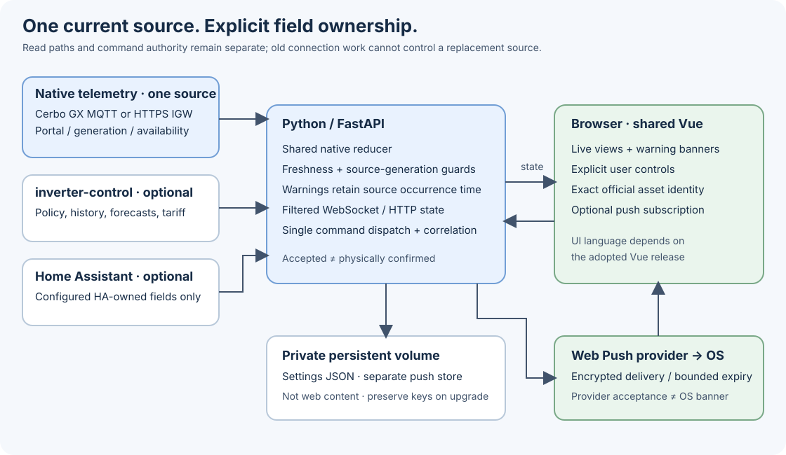

# Inverter Dashboard · Python

[](docs/fuzzing.md)

[English](README.md) · [Русский](README.ru.md) · [Українська](README.uk.md) · [Deutsch](README.de.md) · [Français](README.fr.md) · [Nederlands](README.nl.md)

A self-hosted web dashboard for Victron systems. Python/FastAPI connects directly to a Cerbo GX over MQTT or to [inverter-gateway](https://github.com/victron-venus/inverter-gateway) (IGW) over HTTPS and serves the shared Vue interface. [inverter-control](https://github.com/victron-venus/inverter-control) supplies optional policy controls, history, forecasts and tariff metadata; live native telemetry does not require it. Optional Home Assistant integration adds explicitly configured devices and appliances.

Use this repository for a Python service, container or NAS installation. [inverter-dashboard-go](https://github.com/victron-venus/inverter-dashboard-go) provides the Go implementation; [inverter-desktop](https://github.com/victron-venus/inverter-desktop) provides the native application. These are related applications, not interchangeable packages.



[Process and results](docs/process-and-results.md): colorful workflow and event-time diagrams, concrete corrections, and the limits of validation.

## What it shows and controls

- Grid/consumption phases, DC and AC solar, battery devices, EV charging, native AC loads, water level and pump/valve state. Unavailable readings remain distinct from measured zero.
- Original Victron warning times, including inactive but unacknowledged warnings. Local banner dismissal and device acknowledgement have different effects.
- A six-choice ESS menu: Off, On, Optimized with battery life, Optimized without battery life, Keep batteries charged and External control, when supported by the controller.
- Freshness- and capability-checked controller flags, native Water Mode, controller-owned persistent Setpoint Override and revision-checked tariff editing. A transport acceptance is not proof that a physical device changed.
- Configured Home buttons, covers, media, scenes, sensors and numbers; no built-in list of personal Home entities. Appliance cards depend on visibility settings and available/active appliance data.
- Controller history, forecasts and daily grid-energy provenance when supplied. A partial day is not represented as a complete day; tariff and cost controls live in their dedicated UI rather than inflating the summary row.
- Optional encrypted Web Push with persistent subscriptions, deduplication and silent reconnect priming. Browser/OS permission is separate from in-app banners.

The bundled UI is identified by [its source manifest](src/inverter_dashboard/static/source-info.json). These README translations do **not** imply that a new six-language UI has already shipped. See [language support](docs/i18n.md) for the distinction between documentation, shared Vue source and adopted release bytes.

## Start locally

Requirements: Python 3.12 or newer and `uv`. The checkout already contains the recorded Vue assets; no frontend build is needed for a normal backend run.

```sh
git clone https://github.com/victron-venus/inverter-dashboard.git
cd inverter-dashboard
uv sync --locked
# Safe first start: loopback web listener, no native source.
GATEWAY_ENABLED=false uv run --locked inverter-dashboard --mqtt-host ""
```

Open `http://127.0.0.1:8080`. No configured source means no live measurements. Before allowing remote access, set a strong `DASHBOARD_SECRET` and configure HTTPS. An empty secret leaves the dashboard's management endpoints unprotected; loopback is the default bind, not an authentication mechanism.

To connect to your system, configure **one** of these paths in a protected environment file or service environment:

- MQTT: `MQTT_HOST`, `MQTT_PORT` (1883 by default), and `CERBO_PORTAL_ID`. Add `MQTT_USERNAME`/`MQTT_PASSWORD` and verified TLS where required.
- IGW: `MQTT_HOST=""`, `GATEWAY_ENABLED=true`, `GATEWAY_URL=https://gateway.example.com`, and `GATEWAY_API_TOKEN`. Add both Cloudflare Access credentials only if that route requires them.
- Both: a reachable MQTT broker is preferred; IGW supplies failover. To deliberately keep IGW primary, leave `MQTT_HOST` empty.

Use your own endpoint and GX portal ID; the `.example.com` names in this documentation are placeholders. Native MQTT needs a configured portal for reliable startup on a silent broker. IGW accepts an HTTPS origin, not a path prefix or redirect. [Configuration and precedence](docs/configuration.md) explains every supported group and persistence.

## Containers and packaged executables

Choose a reviewed [release](https://github.com/victron-venus/inverter-dashboard/releases), its matching checksums and channel deliberately. Beta/RC releases are previews. The ZIP packages include the Python runtime and UI for Linux x86_64, macOS arm64/x86_64 and Windows x86_64. Verify the ZIP against its `.sha256` file before extracting, then run `inverter-dashboard --help` (or `inverter-dashboard.exe --help`). Keep configuration and writable state outside replaceable binaries.

For containers, use a pinned image digest from your approved registry. The public [Compose example](docker-compose.yml), [Portainer example](portainer-stack.yml) and [k3s runbook](deploy/k3s/README.md) require local adaptation; they are not production-specific configuration. Publish the container port explicitly, set `HOST=0.0.0.0` inside the container when needed, and protect the exposed route with TLS and dashboard authentication. Runtime UID/GID is 1000; provision readable configuration and writable private state for that identity.

Set `INVERTER_DASHBOARD_SETTINGS_FILE=/var/lib/inverter-dashboard/settings/dashboard_settings.json` on a persistent writable volume if `/app/config` is read-only. With Web Push enabled, use a separate `WEB_PUSH_DATA_DIR=/var/lib/inverter-dashboard/notifications` on that volume and one application process/replica. Preserve it across upgrades; it contains the VAPID identity, subscriptions and deduplication state. Do not mount private state below the static asset directory.

## Home Assistant and appliance setup

Run `bash scripts/init-config.sh` once, then edit the ignored `local_config.py`. For containers, mount it in `INVERTER_DASHBOARD_CONFIG`. `HA_URL`, `HA_TOKEN` and `HA_DIRECT_CONTROLS=True` enable the configured direct HA integration. Keep the file private; never commit a real token.

`HA_SWITCH_ENTITIES` is a dictionary keyed by stable Home button names. Each value may be an entity ID string, an `(entity, label)` pair, or an object with `entity`, `label`, `order` and `enabled`. An empty dictionary (`{}`) means no Home buttons; disabled entries are not displayed, polled or permitted as toggle targets. Use your actual entities rather than copying somebody else's installation. Native power, Water, EV and controller policy fields retain their own owners and cannot be replaced with HA mirrors.

Map your own `HA_APPLIANCE_ENTITIES` for dishwasher/washer/dryer data. A card does not become a reliable active-state indicator merely because a timer entity exists. Visibility preferences and source availability still apply; a shared outlet meter is not an individual appliance measurement. [The configuration guide](docs/configuration.md#home-assistant) includes a minimal example and rich-entity options.

## Notifications and safety

In-app banners use the source occurrence time, not the time you reconnected. Unknown times remain unknown. Web Push is opt-in: set `WEB_PUSH_ENABLED=true`, provide durable private storage, then enable it through the browser's notification settings. The test button confirms queuing, not OS display. Supported server platforms, event priming, expiry, provider restrictions and troubleshooting are documented in [Notifications](docs/notifications.md).

Commands require a connected current source, recent authoritative observations and the appropriate capability. Switching source invalidates old callbacks and pending work. Do not automate around a disabled control or retry an uncertain physical command blindly. Setpoint Override is intentionally independent of DRY mode and remains controller-owned until stopped; use the explicit stop action to clear it. [Architecture and command boundaries](docs/architecture.md) describe acknowledgements and failure behavior.

HTTPS clients validate certificates and hostnames; configure a trusted private CA instead of disabling verification. See [TLS policy](docs/tls-policy.md) and [Security](SECURITY.md). Scrub credentials, endpoint capabilities, private addresses and tokens from issue reports and logs. Legacy token-in-URL access can leak through browser history or proxy logs; prefer a protected same-origin deployment and header-based API clients.

## Troubleshooting

- `/health/live` checks the HTTP process only. An HTTP 200 does not prove fresh Cerbo or HA data.
- `/api/state` returns health/connectivity information without authentication, and adds live state when authorized. With a configured secret, a missing token can explain an apparently empty fallback response.
- If IGW should be primary, check that `MQTT_HOST` is empty. For direct MQTT, verify the portal, broker permissions and native keepalive path.
- A disabled control can mean stale data, unsupported capability, unavailable device or an absent direct HA connection. It should not be made clickable by bypassing those checks.
- Failed settings saves usually require checking the configured writable path, permissions and free space. Replacing a pod with ephemeral storage loses local preferences.
- If the UI appears old, compare the served build/source manifest with the approved release before clearing browser data. Preserve notification subscriptions and private server state.

More diagnosis steps are in the [wiki troubleshooting guide](docs/wiki/Troubleshooting.md). Never attach raw stores, private configuration or access tokens to a public issue.

## Documentation and development

- [Configuration](docs/configuration.md), [architecture](docs/architecture.md), [notifications](docs/notifications.md), [language support](docs/i18n.md)
- [Repository wiki](docs/wiki/Home.md), [developer guide](docs/development.md), [contributing](CONTRIBUTING.md)
- [Frontend provenance](docs/frontend-assets.md), [TLS policy](docs/tls-policy.md), [OpenSSF evidence](docs/openssf-evidence.md), [RC-only fuzzing](docs/fuzzing.md)

Run `bash scripts/ci.sh` for the repository's authoritative validation. Use isolated fixtures; unit tests do not authorize real actuator commands. Backend changes and shared Vue changes have separate source/release identities. Do not edit generated minified assets to fix a frontend defect.

<!-- ci-release-process:start -->
## Release process

See the [release strategy](RELEASING.md) for validation, nightly, beta, RC and stable promotion rules, and the [operator runbook](docs/release-workflow.md) for local commands.
<!-- ci-release-process:end -->

The [MIT license](LICENSE) applies. Report vulnerabilities privately through [SECURITY.md](SECURITY.md).

## Browser compatibility

The [embedded frontend acceptance suite](docs/browser-compatibility.md) verifies the shipped SPA in real browser engines across Linux, Windows and macOS. Its required matrix is part of the existing CI gate, with expanded version coverage for scheduled and manual release qualification.
