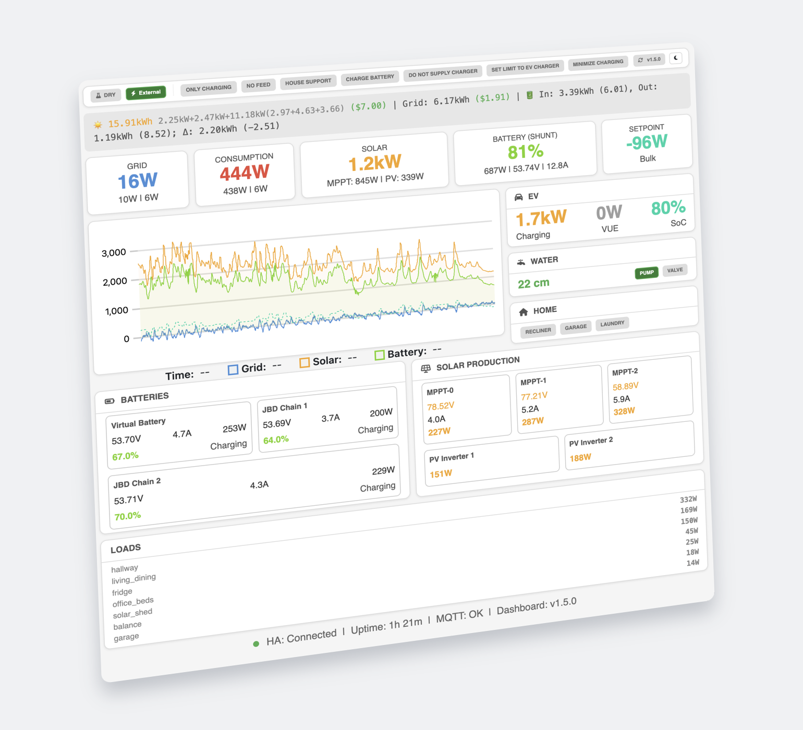

# Inverter Dashboard · Python

[English](README.md) · [Русский](README.ru.md) · [Українська](README.uk.md) · [Deutsch](README.de.md) · [Français](README.fr.md) · [Nederlands](README.nl.md)

Веб-панель для самостоятельного размещения и наблюдения за системой Victron. Сервер Python/FastAPI получает нативные данные Cerbo GX по MQTT либо через HTTPS [inverter-gateway](https://github.com/victron-venus/inverter-gateway) (IGW) и обслуживает общий интерфейс Vue. Необязательный [inverter-control](https://github.com/victron-venus/inverter-control) предоставляет режимы управления, историю, прогнозы и тарифы. Для самих нативных показаний он не требуется. Home Assistant добавляет только настроенные вами устройства.

Эта версия подходит для Python-сервера, контейнера и NAS. Также существуют [версия Go](https://github.com/victron-venus/inverter-dashboard-go) и [нативное приложение](https://github.com/victron-venus/inverter-desktop); их пакеты не взаимозаменяемы.

[](images/Screenshot.png)

*Историческая иллюстрация интерфейса версии 1.5.0; это не снимок текущего релиза. [Открыть исходный скриншот](images/Screenshot.png).*


[Процесс и результаты](docs/process-and-results.md): цветные схемы работы и времени событий, конкретные исправления и границы проверки.

## Возможности

- Сеть и потребление по фазам, солнечная генерация DC/AC, устройства батарей, зарядка EV, нативные нагрузки, уровень воды, насос и клапан. Недоступное значение не превращается в ноль.
- Предупреждения Victron с исходным временем события, включая неактивные, но ещё не подтверждённые предупреждения.
- Шесть режимов ESS при поддержке контроллером: Off, On, Optimized with battery life, Optimized without battery life, Keep batteries charged и External control.
- Управление с проверкой доступности, свежести и возможностей: флаги контроллера, Water Mode, постоянный Setpoint Override и тариф с проверкой ревизии. Принятие команды транспортом не доказывает физическое выполнение.
- Настраиваемые кнопки Home, шторы, медиаплееры, сцены, датчики и числовые параметры. Личного списка HA-сущностей в коде нет. Карточки бытовой техники зависят от видимости и доступных/активных данных.
- История, прогнозы и суточная энергия с указанием полноты данных. Неполные сутки не выдаются за полные; тарифные настройки не раздувают верхнюю строку.
- Добровольные системные уведомления Web Push с постоянным хранилищем, дедупликацией и тихой первичной загрузкой после переподключения.

Встроен официальный артефакт **Vue v2.2.11-beta.1** (версия пакета `2.2.11-beta.1`, исходник `01eae482124cd958dd110e362769ba5817d44b6e`). [Данные о происхождении](src/inverter_dashboard/static/source-info.json) содержат метаданные и хеши файлов. Это предварительная бета-версия, опубликованная сборкой `39405183480`, а не принятая RC или стабильный выпуск. Тексты интерфейса, даты, время, сохранённые ошибки приложения и подписи тем поддерживают английский, русский, украинский, немецкий, французский и нидерландский языки; сообщения внешних источников сохраняют исходный текст. Подробнее — [поддержка языков](docs/i18n.md).

## Локальный запуск

Нужны Python 3.12+ и `uv`. Проверенные файлы Vue уже находятся в репозитории; обычный запуск сервера не требует пересборки интерфейса.

```sh
git clone https://github.com/victron-venus/inverter-dashboard.git
cd inverter-dashboard
uv sync --locked
# Первый запуск без подключения к оборудованию, только на loopback.
GATEWAY_ENABLED=false uv run --locked inverter-dashboard --mqtt-host ""
```

Откройте `http://127.0.0.1:8080`. Без источника живых показаний не будет. Перед удалённым доступом задайте случайный `DASHBOARD_SECRET` и HTTPS. Пустой секрет означает незащищённые управляющие API; локальный адрес прослушивания сам по себе не является аутентификацией.

Для MQTT задайте `MQTT_HOST`, `MQTT_PORT` и `CERBO_PORTAL_ID`, при необходимости — учётные данные и проверяемый TLS. Для IGW задайте `MQTT_HOST=""`, `GATEWAY_ENABLED=true`, `GATEWAY_URL=https://gateway.example.com` и `GATEWAY_API_TOKEN`. Два параметра Cloudflare Access нужны только для соответствующего защищённого маршрута и задаются вместе. `.example.com` — пример, а не действующий сервис.

Если настроены оба транспорта, доступный MQTT предпочтительнее IGW; для строго IGW оставьте MQTT-адрес пустым. На молчащем MQTT-брокере явно указанный портал нужен для надёжного старта. URL IGW должен быть HTTPS origin без префикса пути и перенаправлений. Сохранённые параметры подключения применяются при запуске; явно переданные `--mqtt-host`/`--mqtt-port` имеют больший приоритет. Подробности: [конфигурация](docs/configuration.md).

## Контейнеры и готовые пакеты

Выберите осознанно канал и [официальный выпуск](https://github.com/victron-venus/inverter-dashboard/releases). ZIP для Linux x86_64, macOS arm64/x86_64 и Windows x86_64 содержит Python и интерфейс. Перед распаковкой сравните SHA-256 с соответствующим файлом `.sha256`; затем используйте `inverter-dashboard --help` или `inverter-dashboard.exe --help`. Beta/RC — предварительные версии.

В контейнере используйте проверенный digest образа, явно опубликуйте порт и при необходимости задайте `HOST=0.0.0.0` внутри контейнера. [Compose](docker-compose.yml), [Portainer](portainer-stack.yml) и [k3s](deploy/k3s/README.md) содержат примеры для адаптации, а не настройки вашей сети. UID/GID процесса — 1000; обеспечьте ему чтение конфигурации и запись в отдельное приватное хранилище.

Для постоянных предпочтений задайте `INVERTER_DASHBOARD_SETTINGS_FILE=/var/lib/inverter-dashboard/settings/dashboard_settings.json` на сохраняемом томе. Каталог `/app/config`, смонтированный как read-only, для записи не подходит. Для Web Push нужен отдельный `WEB_PUSH_DATA_DIR=/var/lib/inverter-dashboard/notifications` на постоянном локальном томе и один процесс/реплика. Сохраняйте ключ VAPID, подписки и дедупликацию при обновлении; не помещайте приватное хранилище в каталог веб-ресурсов.

## Home Assistant и бытовая техника

Выполните `bash scripts/init-config.sh` и отредактируйте игнорируемый Git файл `local_config.py`. В контейнере каталог выбирает `INVERTER_DASHBOARD_CONFIG`. Укажите личные `HA_URL`/`HA_TOKEN` и включите `HA_DIRECT_CONTROLS=True`, если нужны прямые HA-операции. Не публикуйте токен.

`HA_SWITCH_ENTITIES` — словарь, ключами которого служат стабильные имена кнопок Home. Значение каждого ключа — строка ID сущности, пара `(entity, label)` либо объект с `entity`, `label`, `order`, `enabled`. Пустой словарь (`{}`) означает отсутствие кнопок. Отключённые записи не отображаются, не опрашиваются и не разрешают команды. Нативные Water/EV/мощность и флаги контроллера нельзя подменить HA-зеркалами. `HA_FILTERED_ENTITIES` задаёт остальные типы карточек.

Для dishwasher/washer/dryer настройте свои `HA_APPLIANCE_ENTITIES` и предпочтения видимости. Существование таймера не доказывает работу прибора; общий счётчик розеток не является индивидуальным измерением стиральной машины. Примеры и ограничения приведены в [руководстве](docs/configuration.md#home-assistant).

## Уведомления и безопасность

Баннер показывает время возникновения, а не время возвращения домой или переподключения. Неизвестное время остаётся неизвестным. Локальное скрытие баннера и подтверждение на устройстве — разные действия. Web Push включается через `WEB_PUSH_ENABLED=true`, постоянное хранилище и явное разрешение в браузере. Кнопка теста подтверждает постановку в очередь, не появление баннера ОС.

Серверный Web Push поддерживается на Linux и macOS Apple Silicon; Windows и Intel macOS сохраняют обычную панель, но сообщают `unsupported_platform` для отправителя. Браузер на этих системах может получать push от Linux-сервера. [Руководство по уведомлениям](docs/notifications.md) описывает сроки, дедупликацию и ограничения браузера.

Управление требует текущего источника и свежих данных. При смене подключения старые команды и callbacks теряют полномочия. Не обходите заблокированные кнопки и не повторяйте неопределённую физическую команду вслепую. Setpoint Override намеренно не зависит от DRY; он выполняется контроллером до явной остановки. Тарифные изменения проверяют ревизию, чтобы не затереть чужое изменение.

Сертификат и hostname проверяются. Для частного CA настройте доверенный пакет, а не отключайте TLS-проверку. Токен в URL может попасть в историю браузера и proxy-логи; для API предпочтителен заголовок Authorization. См. [TLS](docs/tls-policy.md) и [Security](SECURITY.md).

## Диагностика и разработка

`/health/live` проверяет процесс, а не свежесть оборудования. `/api/state` без авторизации отдаёт сведения о подключениях; живые поля требуют авторизации, если задан секрет. При пустых данных проверьте выбранный транспорт, портал и права брокера. Заблокированная кнопка может означать устаревшее состояние, отсутствие возможности либо недоступное устройство. Ошибка сохранения требует проверки пути, прав и свободного места; ephemeral-том не сохраняет настройки после замены pod.

При старом интерфейсе сначала сравните фактически обслуживаемый build с утверждённым выпуском. Не удаляйте подписки и серверные ключи наугад. [Wiki](docs/wiki/Home.md), [диагностика](docs/wiki/Troubleshooting.md), [архитектура](docs/architecture.md), [разработка](docs/development.md) и [правила участия](CONTRIBUTING.md) содержат дальнейшие шаги. Основная проверка — `bash scripts/ci.sh`; тесты используют изолированные данные, а не реальные исполнительные устройства.

[Стратегия выпуска](RELEASING.md) и [операторский процесс](docs/release-workflow.md) определяют переход от beta к RC и stable. Слияние PR само по себе не означает stable-релиз. Лицензия — [MIT](LICENSE); уязвимости сообщайте приватно по [SECURITY.md](SECURITY.md).
