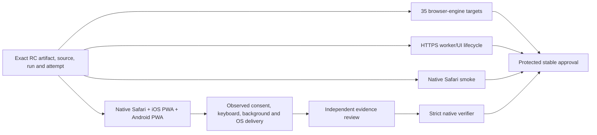

# Native browser, installed PWA and notification acceptance

[Browser compatibility](browser-compatibility.md) · [Notification behavior](notifications.md)

The desktop browser-engine matrix, the isolated PWA regression lane, native Safari smoke, and native installed-app acceptance are different evidence sets. A green Playwright WebKit run is not a Safari run. A provider response or a Service Worker API success is not an observed operating-system notification.



## What is executable

- `scripts/pwa_acceptance.cjs` serves the exact candidate frontend over disposable loopback HTTPS and enables real Service Workers. It exercises the real notification settings UI, worker activation/root scope, persistent IndexedDB settings, stale enable-generation rejection, revoked settings across a same-byte update check, subscription deletion, absence of an offline asset cache, and unregister. Permission decisions use browser test overrides. **PushManager/provider registration is an isolated fixture**, clearly named in the receipt; it does not send to APNs/FCM or prove real subscription delivery. The lane uses full Chromium new-headless mode (`channel: chromium`) and a disposable persistent profile; the default headless shell and incognito notification restrictions cannot qualify this lifecycle. CDP permission overrides remain attached for the test and never change OS settings. Broader engine coverage remains the separate browser matrix.
- `scripts/native_acceptance_smoke.cjs` starts an isolated HTTPS/WSS fixture on an ephemeral macOS CI runner, trusts only its disposable test certificate, starts the installed `safaridriver`, and runs `scripts/native_acceptance_webdriver.py`. The test observes the actual Safari identity, secure context, hydrated candidate telemetry, settings/notification section and exact worker hash. The certificate and processes are cleaned up. This is **partial native smoke**, not installed-PWA/keyboard/push acceptance.
- `scripts/native_acceptance_capture.py` creates **pending** native observation forms bound to the exact candidate. It cannot approve them or overwrite existing observations.
- `scripts/native_acceptance.py verify` rejects missing/failed/skipped targets or scenarios, wrong candidate/run/attempt/artifact hashes, unreviewed evidence, emulation presented as native, and provider acceptance presented as OS display. It accepts only independently reviewed, complete native evidence.

Release harnesses require the GitHub Actions environment. A test owner may qualify the engine-only harness in an isolated headless development subprocess with an explicitly emulated runner context and a `synthetic-control/not-release` candidate binding; those results must be labelled synthetic local controls and cannot count as release or native evidence. This does not permit local native WebDriver execution or use of a personal browser profile. Local browser, simulator and device UI must be operated through `cua_repl` under the current user's coordination window; hosted test code may use the native automation APIs. No test here needs real inverter, battery, pump, valve, camera, or household writes.

## Candidate boundary

Use `scripts/prepare_browser_candidate.py` to verify/extract the producing job's exact immutable artifact. Both the broad engine matrix and these lanes use that candidate; do not rebuild or substitute the frontend. `candidate.json` carries:

```json
{
  "repository": "victron-venus/inverter-dashboard",
  "sourceSha": "<40 lowercase hex>",
  "runId": 123,
  "runAttempt": 2,
  "candidateArtifactId": 456,
  "candidateSha256": "<64 lowercase hex>",
  "distribution": ".compatibility/candidate/frontend",
  "frontendFiles": {"notifications-sw.js": "<64 lowercase hex>"}
}
```

CLI inputs, extracted candidate files, toolchain paths and outputs must remain inside the repository checkout; parent traversal and symbolic links are rejected before file access. A pure unit helper can use an isolated temporary root, but no CLI option changes the trusted root. Outputs cannot overwrite verifier inputs or source evidence.

The example is schematic, not usable acceptance evidence. Go uses its own repository, run and package digest. Never reuse Python native evidence for the Go backend, or a different candidate/attempt. `artifactId`/`archiveSha256`, when present as aliases, must agree. The upstream verifier additionally binds package producer and OCI receipt. Keep the full producer receipt with the candidate evidence; a manually typed digest does not establish artifact provenance.

## Release workflow integration

`.github/workflows/native-browser-acceptance.yml` consumes the same immutable
candidate artifact ID as packaged browser qualification. It runs the PWA engine
lane for candidate builds, and actual hosted Safari smoke for RC builds. The
preservation job in `.github/workflows/browser-release-evidence.yml` requires the
exact nine PWA scenarios and, for RC, four native Safari smoke scenarios, with the
same source/run/attempt/candidate digest. It retains their JSON and the hashed
native screenshot in `browser-qualification.tar.gz`, staged with the frozen
release plan/version receipt. This is release evidence, not a native-mobile pass.
The generated publisher authenticates/promotes the original RC evidence but does
not invoke the complete manual native verifier automatically.

## Hosted engine/PWA invocation

Install the repository's pinned Playwright toolchain and Chromium, then:

```bash
CI_PWA_CANDIDATE="$PWD/.compatibility/candidate/candidate.json" \
CI_PLAYWRIGHT_MODULE="$PWD/tools/browser-compatibility/playwright-1-64-0/node_modules/playwright" \
CI_PWA_OUTPUT="$PWD/.compatibility/pwa" \
node scripts/pwa_acceptance.cjs
```

Run this in GitHub Actions, which provides `GITHUB_ACTIONS=true`. The lane uses OpenSSL, Node and the installed pinned toolchain. It does not change the host trust store. It records `scope: engine-pwa-isolated`, `permissionMechanism: browser-test-override`, `subscriptionMechanism: isolated-ui-fixture`, and `osNotificationObserved: false`. It preserves a trace, screenshot and failure record. These diagnostics are synthetic and must contain no production subscription endpoint, bearer token or VAPID private key.

The current worker intentionally has **no fetch handler and no asset cache**. Do not promise offline telemetry/control or offline installation. `registration.update()` with identical candidate bytes checks persistence and cache policy; it does not qualify migration from a different prior worker. The native upgrade scenario separately requires the actual prior worker hash to differ from the candidate hash.

## Hosted Safari invocation

On the disposable macOS runner after candidate preparation:

The checked-in workflow passes the documented outputs directly from its pinned
`setup-python` step; there is no fallback to `pythonLocation` or shell lookup:

```yaml
- name: Exercise installed Safari in the disposable hosted runner
  env:
    CI_NATIVE_PYTHON: ${{ steps.python.outputs.python-path }}
    CI_NATIVE_PYTHON_VERSION: ${{ steps.python.outputs.python-version }}
    CI_PWA_CANDIDATE: ${{ github.workspace }}/.compatibility/candidate/candidate.json
    CI_NATIVE_OUTPUT: ${{ github.workspace }}/.compatibility/native-safari
  run: node scripts/native_acceptance_smoke.cjs
```

The script uses the installed `/usr/bin/safaridriver`, the verified CPython 3.12 interpreter, and `/usr/bin/sudo /usr/bin/security` on the disposable runner's system keychain and an ephemeral loopback HTTPS origin. OpenSSL, sudo, security and safaridriver use fixed system paths and a fixed system `PATH`. Python comes from the pinned `setup-python` action’s explicit `python-path` output, resolves only to the corresponding approved hosted toolcache/framework installation, and must report the selected CPython 3.12 version before execution. Arbitrary environment interpreter locations and PATH lookup are rejected. Teardown attempts both matching admin trust removal and certificate deletion by its SHA-256 fingerprint, including after a partial or timed-out trust installation. Its loopback WebSocket handshake uses SHA-1 solely because RFC 6455 requires that wire format; [RFC 6455 section 10.8](https://www.rfc-editor.org/rfc/rfc6455.html#section-10.8) explains that the handshake relies on none of SHA-1’s security properties. Candidate/evidence integrity continues to use SHA-256. No user machine keychain or Safari preferences are touched. The resulting `native-smoke.json` is labelled `native-host`; it records actual driver/browser versions, measured macOS version/build/architecture, and its limitations. A screenshot proves only what is visible in that captured browser view.

The interpreter preflight allows the documented toolcache `bin` link into the matching macOS Python framework, then verifies the canonical executable and its ancestors contain no links, checks execute permissions and measures the selected CPython 3.12 version. The version probe uses isolated mode; the actual helper uses `-E -s` to ignore Python environment/user-site overrides while retaining trusted sibling imports. See the [pinned setup-python outputs](https://github.com/actions/setup-python/blob/6d4fd22b20465ccc0f7354476588e8df7c9ca0e0/action.yml) and [macOS installer layout](https://github.com/actions/python-versions/blob/0bd7e714026678b92b30805abbd061c8ac04ffc5/installers/macos-pkg-setup-template.sh).

The WebDriver HTTP client validates a loopback HTTP origin, disables environment proxies and redirects, retains a 45-second network timeout, bounds JSON responses to 8 MiB and validates the W3C response envelope.

The candidate document receives an enforced Content Security Policy that confines its scripts, connections, images, fonts and workers to the isolated fixture or explicitly allowed in-document data. The harness requires an intentional blocked cross-origin loopback probe, its enforced DOM event, and a server report bound to the exact policy and fixture origin. WebKit's legacy report may omit `disposition`; this is accepted only with those policy/origin bindings and the separate DOM event declaring `enforce`. An explicit report-only observation is rejected. Unexpected candidate violations or malformed reports fail the smoke; HTTP settings/control writes are refused and counted as failures. This isolation covers **candidate document resources**, not browser background services or host networking.

The child writes `native-smoke.provisional.json` with `pending-parent-validation` only after the four observations and successful WebDriver session deletion. A deletion error leaves a failed provisional receipt. The parent creates the final `native-smoke.json` exclusively after checking application frames, protocol errors, HTTP writes, CSP evidence and all teardown results. It requires driver termination, confirmed HTTPS listener closure, admin trust removal, certificate removal and temporary-directory cleanup; a timeout or cleanup error cannot produce a passing final receipt. The release collector rejects unfinalized observations. Unit tests and isolated Chromium/WebKit controls exercise these failure paths, but only the actual hosted Safari job supplies native smoke evidence for a release candidate.

The portable WebDriver helper also accepts `--platform iOS --runtime native-simulator`, or Android with `--runtime native-emulator`, against an already qualified loopback fixture and driver. This is an executable transport, **not a declaration that mobile infrastructure was provisioned**. Device/simulator permissions, trusted HTTPS reachability, driver capabilities and installed browser availability must first be established by the infrastructure owner. The standalone hosted orchestration currently provisions macOS Safari only.

Apple supports Safari WebDriver on iOS Simulator as well as an attached device. WebDriver's automation window suppresses system notifications and the software keyboard, so an otherwise successful iOS WebDriver smoke cannot supply those native observations. See [Apple's Safari WebDriver explanation](https://webkit.org/blog/9395/webdriver-is-coming-to-safari-in-ios-13/).

## Complete native capture and review

The checked-in `.github/native-acceptance-policy.json` requires three targets:

- macOS with branded Safari, in browser mode;
- iOS with Safari's installed standalone Home Screen app;
- Android with Chrome's installed standalone app.

Record the exact OS version/build, browser version, user agent, device model and runtime for each. Native iOS simulators and Android emulators are legitimate when they can actually perform every required observation; browser viewport emulation is not. OS notification delivery must be observed on that runtime. Do not mark an unavailable push service, software keyboard, simulator capability, installation, or device as passed. The receipt qualifies the recorded versions only, not every version of an OS family.

For iOS Web Push, use a Home Screen web app and a direct user interaction to request permission. Apple documents support beginning with iOS/iPadOS 16.4; merely opening a Safari tab is not the installed PWA scenario. See [WebKit's Web Push documentation](https://webkit.org/blog/13878/web-push-for-web-apps-on-ios-and-ipados/).

Start the forms:

```bash
python3 scripts/native_acceptance_capture.py \
  --candidate .compatibility/candidate/candidate.json \
  --output .compatibility/native-observations \
  --observer '<observer identity>'
```

Use an isolated deployment of the exact candidate, synthetic device sources, dedicated browser profiles and a supported sender host. Keep candidate identity visible in the deployment/session evidence. Use normal browser/system permission UI. Preserve existing real user subscriptions/configuration. Capture dated screenshots/video or native device test logs plus sanitized sender-stage diagnostics; never record secrets or full push endpoint capabilities.

The required scenarios are the exact lists in the policy. Their measured details are validated by `validate_details` in `scripts/native_acceptance.py`:

1. Observe the native OS/runtime inventory and branded browser identity.
2. Verify updated telemetry, original alarm occurrence time, External choices, and rejected controls against fixtures only.
3. Verify editable settings and visible controls; on mobile, observe actual touch input and the software keyboard.
4. For mobile, launch from the installed icon and observe standalone display mode.
5. Background/resume, change the fixture source epoch, and prove an old event cannot overwrite fresh data.
6. Deny permission through system UI: no registration appears. Grant through a user gesture: browser and server registration are confirmed.
7. Disable: local intent, server registration and browser subscription are all revoked. Do not confuse worker unregister with subscription deletion.
8. Update a previously installed worker to the exact candidate worker hash. Record both differing hashes, preserved settings, root scope and empty asset cache.
9. Close the dashboard tab/app view, queue one uniquely identified synthetic test event, and retain separate queue/provider diagnostics. Observe the actual OS banner/notification center item and original event time. A provider 201, a queued 202, or `showNotification()` returning does not meet this step.
10. Click that same observed event: the dashboard root opens and no control command is emitted.

Each scenario has `id`, `status`, timezone-qualified `observedAt`, `artifact: {path, sha256}`, and measured `details`. Artifact paths must be relative to the evidence directory, regular nonempty files, without traversal or symlinks. `status` must be `passed`; `pending`, `unsupported` and `skipped` are not success. Record an honest failure/pending item when an observation is unavailable. Do not modify a historical receipt to pretend a different candidate passed.

A complete receipt additionally has `schemaVersion: 1`, `scope: native-complete`, `targetId`, the canonical `candidate`, `observer`, `startedAt`, `finishedAt`, and `identity`. The independent reviewer must inspect the underlying evidence and environment identity, then produce `native-review.json` with `status: accepted`, `reviewer`, the original `observer`, `reviewedAt`, candidate binding, and exactly one `{targetId,path,sha256}` reference per target receipt. Recompute receipt hashes after recording observations. The capture helper deliberately leaves the review pending.

```bash
python3 scripts/native_acceptance.py verify \
  --candidate .compatibility/candidate/candidate.json \
  --evidence-root .compatibility/native-observations \
  --review .compatibility/native-observations/native-review.json \
  --output .compatibility/native-verdict.json
```

Every invocation requires a fresh output path. Existing verdicts and unrelated files are rejected and preserved; successful output uses exclusive creation. A failed invocation exits nonzero and cannot create a positive verdict, and an older receipt must never be substituted for that failed invocation. The successful output binds all accepted target receipt hashes to the candidate and includes the observed versions and scenario counts.

## Enforcement and remaining boundary

This repository-owned verifier is a required operator preflight before protected stable approval. It does **not** by itself modify the shared release engine or GitHub environment protection. The release operator must authenticate the review identity and immutable evidence artifact through the protected workflow/approval process, and verify this command succeeded for the selected RC before approving stable. JSON fields and hashes establish consistency; they cannot authenticate an arbitrary author's assertion or prove a screenshot depicts genuine OS delivery. Do not claim stable enforcement is automatic unless the relevant workflow/protection actually requires this verdict.

Beta and RC builds can carry explicit incomplete native qualification while the team collects evidence. Native smoke and engine success must remain labelled partial. Stable still promotes the accepted RC bytes, never a rebuilt candidate. Missing native evidence means native acceptance is incomplete, even when all ordinary CI is green.

Contract checks, without a browser or device:

```bash
python3 -m unittest discover -s scripts -p 'test_native_acceptance*.py'
node --test scripts/pwa_acceptance.test.cjs
```
