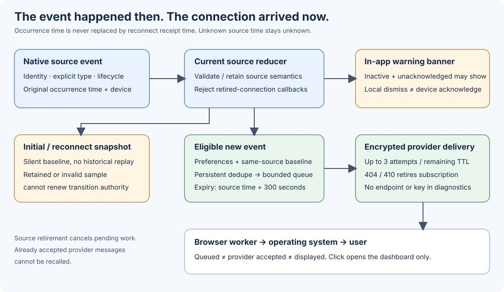

# Notifications: event time, banners and Web Push

[README](../README.md) · [Configuration](configuration.md) · [Troubleshooting](wiki/Troubleshooting.md)

## Native warning banners

Native notification identity, type, description, device and occurrence time come from the source. Banners can include inactive but unacknowledged Victron warnings: inactivity alone does not mean acknowledged. Acknowledged/history entries are not reclassified as new active alarms. Missing or invalid occurrence time stays unknown; reconnect receipt time is never substituted as “just now”. Relative age and the exact local date/time are presentation of the original event time.

Local dismissal hides a banner in the dashboard's notification state. Device acknowledgement or silence is a distinct command with a current source/client/portal fence and bounded deadline. A failed physical acknowledgement does not become a success because the local banner was dismissed. Neither ordinary page load nor notification click issues device commands.

## Optional server Web Push

Enable `WEB_PUSH_ENABLED=true`, set a private persistent `WEB_PUSH_DATA_DIR`, and choose a valid HTTPS or mailto contact URI in `WEB_PUSH_SUBJECT` if overriding the project default. The contact URI is not a callback endpoint. Browser settings then request notification permission through an explicit user gesture and register the browser subscription with the server.

Linux and macOS Apple Silicon support the server sender with its private Unix store. Windows and Intel macOS hosts report `unsupported_platform` for server push while retaining ordinary telemetry and banners. Browsers on those systems can still subscribe to a supported Linux server. Browser-specific secure-context, installation and OS permission requirements still apply; support in JavaScript alone does not prove OS display.

Keep one process/replica per store on a local persistent filesystem. The application holds an exclusive lock; directory/files are private (0700/0600). Existing corrupt, missing or inaccessible initialized state is not silently replaced with new keys. Storage unavailability disables push while ordinary telemetry continues. Preserve the full private store on upgrades and protect backups; do not copy VAPID keys into public issue reports.

## What creates an event

Native Victron/controller warning events require a usable source occurrence time and explicit supported severity/type. Existing alerts prime silently at the first complete snapshot and reconnect. MQTT has a silent initial ten-second hydration period; unknown-time baseline hydration is not a new alarm. A genuinely new later occurrence remains eligible even when a slot is reused.

The optional synthetic categories are selected charger power transitions between >10 W and ≤10 W, pump/valve state transitions between 0 and 1, and actual native battery SoC crossing from >20% to ≤20%. Each requires a fresh prior sample in the same source epoch; a prior sample expires after 30 seconds. Retained or invalid samples cannot renew the baseline. Backward clock movement reprimes instead of manufacturing a transition. Voltage-derived display SoC and near-zero grid watts are never used to invent a low-battery or grid-loss event.

Preferences choose categories. On source retirement the server cancels queued/in-flight work associated with that epoch. A push provider that already accepted a message cannot be recalled. Deduplication and source event time survive normal service restarts through the persistent store.

## Delivery and privacy limits

Each event expires 300 seconds after its source time. Delivery has at most three attempts; the remaining TTL is sent to the provider. HTTP 404/410 retires the expired subscription. Queue ownership is rechecked before applying outcomes so an old send cannot delete a replaced registration. The store bounds subscriptions to 64, deduplication entries to 4096 and pending deliveries to 1024. Preferences changes/unsubscription discard corresponding pending work.

The sender uses maintained Web Push encryption/signing libraries. HTTPS delivery is restricted to supported public provider hosts, resolves and pins a permitted public IP, checks TLS certificates/hostnames, refuses redirects and proxies, and bounds request time. Private/special-address routes and unsupported providers are rejected. Diagnostics expose bounded stage/status categories, not endpoint capability URLs, private keys or raw provider bodies.

`POST /api/notifications/test` returns HTTP 202 with `queued=true`. That proves only queuing. A provider 201 is acceptance by the provider, not proof of browser receipt or an OS banner. Test closed-tab delivery separately with explicit user permission; record browser, origin and observed result without inventing success.

## API and worker boundaries

`GET /api/notifications/status` reports capability and the public VAPID key. `POST /api/notifications/subscription/status`, `POST/DELETE /api/notifications/subscription` and `POST /api/notifications/test` use the current browser endpoint in a JSON body, never a query parameter. Registration carries subscription keys and category preferences. Existing dashboard authentication applies. Mutation requests additionally require same-origin HTTPS Origin/Host, JSON, bounded body/time and rate limits. Even localhost development must satisfy the API's HTTPS origin contract to register push.

The public `/notifications-sw.js`, `/manifest.webmanifest` and `/notification-icon.svg` are narrowly served with no-cache headers and root worker scope. The worker has no asset-cache/fetch handler and no actuator actions. It validates incoming data and origin-bound page messages. A click opens the dashboard root only.

See [frontend provenance](frontend-assets.md) before diagnosing stale worker bytes, and [TLS policy](tls-policy.md) before changing trust configuration. A missing banner must be traced through server queue, provider acceptance, worker receipt and OS permission as separate stages.
