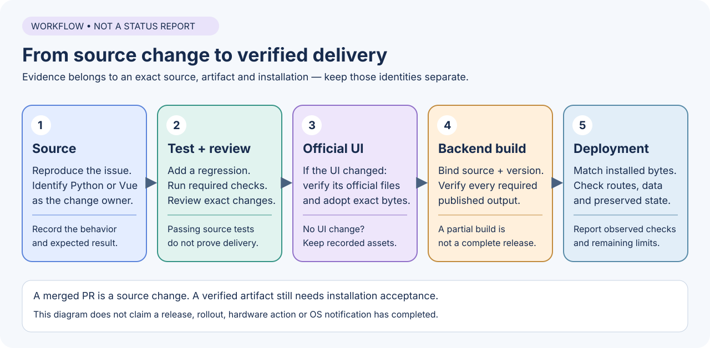
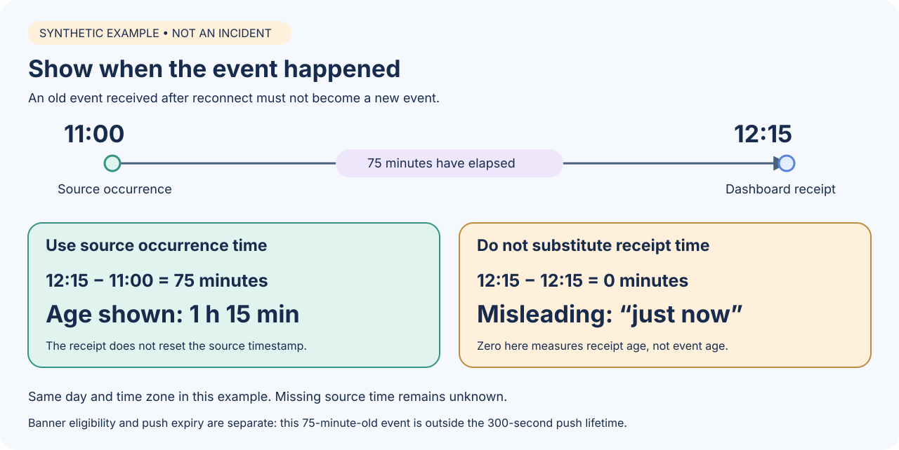

# Process and results

[README](../README.md) · [Architecture](architecture.md) · [Development](development.md) · [Wiki](wiki/Process-and-results.md)

This guide connects a change to the evidence needed to use it. The workflow below describes how work should progress; it is not a report that a particular release, deployment or operating-system notification has completed. Consult the exact source commit, release records and installed build for that question.

## From a source change to an installed result

1. **Identify the behavior and its owner.** Reproduce a concrete issue with isolated data. Python owns source selection, configuration, HTTP/WebSocket delivery and command checks. The separate Vue project owns shared UI presentation. Record the input, expected result and actual result before changing the responsible layer.
2. **Test and review the source.** Add a regression that fails for the observed defect, run the affected checks and required CI, then review the exact changes. Mocked clients should establish state and command boundaries without operating equipment. A passing test describes the tested behavior, not every downstream stage.
3. **Adopt official UI bytes when the UI changed.** Review and release Vue in its own repository. Verify the official artifact's source, inventory and checksums, then copy its exact bytes and truthful provenance into Python. A Python-only correction does not require a replacement UI. Do not edit generated JavaScript or call a local preview an official artifact. See [frontend adoption](frontend-assets.md).
4. **Build and verify the backend release.** Use the [release policy](../.release-policy.json) and [release guide](../RELEASING.md). Bind the source, channel, version and complete required output set. An individually successful build job or a merged PR is not evidence that all release outputs were published and verified.
5. **Verify the installation separately.** Match the installed package or image and served UI to the selected release. Check startup, expected routes, fresh telemetry, configuration and persistence. Preserve settings, configured Home devices and any Web Push identity/subscriptions. A read-only acceptance check must not issue an actuator command or acknowledge an alarm. Follow the [operator workflow](release-workflow.md) and report unresolved checks explicitly.

## Concrete Python outcomes

### Explicit MQTT CLI values survive startup

Previously, startup could apply saved connection settings after command-line parsing and replace an explicitly supplied MQTT host or port. The current [startup implementation](../src/inverter_dashboard/server.py) retains the explicit CLI values and applies them after saved overrides. An explicit empty `--mqtt-host ""` remains meaningful; omitted flags still allow saved/default configuration.

The [lifecycle regression](../tests/test_server_lifecycle.py) exercises argument parsing through application startup with saved settings and mocked source initialization. It covers omitted arguments, host-only, port-only and explicit empty-host cases. It does not prove a connection to a real broker. Disabling MQTT alone also does not disable separately configured IGW or HA integrations; isolate all configuration for an offline preview.

### Home configuration uses a dictionary

`HA_SWITCH_ENTITIES` is a dictionary keyed by stable Home button names. Each value may be an entity ID string, an `(entity, label)` pair, or an object with `entity`, `label`, `order` and `enabled`. An empty dictionary (`{}`) produces no Home buttons. The documentation correction makes this distinction explicit; it does not add a new accepted configuration format.

The [HA parser](../src/inverter_dashboard/ha_client.py) requires a dictionary at the top level and sorts entries by integer `order`, preserving declaration order for equal ranks. Disabled entries are excluded. The [configuration example](../local_config.example.py) and [configuration guide](configuration.md#home-assistant) show the accepted structure without a personal device inventory. These guarantees do not establish that any configured entity currently exists or is available in HA.

## Event time is different from receipt time

The diagram is an illustrative calculation, not a captured incident or benchmark. Assume the same day and time zone: an event occurred at **11:00**, and the dashboard received it at **12:15**. Its age at receipt is **75 minutes**, or **1 h 15 min**. Subtracting receipt time from itself gives zero and would misrepresent the event as new.

The native [notification reducer](../src/inverter_dashboard/notifications.py) preserves source occurrence time; the adopted shared UI formats its age. A missing or invalid occurrence time remains unknown. A source reconnect must not manufacture a new timestamp. An inactive but unacknowledged warning can remain eligible for a banner, while acknowledged history is not reclassified as a new alarm.

Banners and Web Push use different eligibility rules. A 75-minute-old alert may still belong in the banner lifecycle, but it is outside the server's 300-second push event lifetime. Initial snapshots and reconnects prime push state silently. See [notification behavior and delivery limits](notifications.md), including why a queued test or provider acceptance does not prove OS display.

## What the evidence does and does not establish

Source regressions establish the particular parsing, ordering, lifecycle or state behavior under test. Documentation checks establish that local links resolve, SVGs parse and the illustrative time calculation is correct. SVGs are editable, self-contained images with text alternatives; their colors do not encode a release status.

Official artifact verification, installed-build checks, browser behavior, OS notification display and physical device behavior are separate observations. This page makes no performance claim and no claim that those acceptance stages have completed for a particular release. Record both successful checks and remaining limits against the exact identities being assessed.
